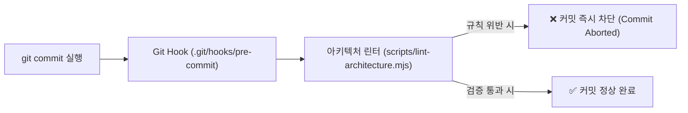

# 📌 Project: Make (Monorepo PoC Testbed & Work Archive)

> **"하나의 저장소 안에서 다양한 독립 웹 애플리케이션을 실험(PoC)하고, 작업 기록을 아카이빙하는 멀티 앱(Multi-App) 정적 플랫폼"**

---

## 1. 아키텍처 비전: Monorepo & Multi-App

본 프로젝트는 **`pnpm Workspaces`** 기반의 모노레포 구조로 설계되어, 각 테스트베드 사이트가 독립적인 기술 스택과 빌드 라이프사이클을 가집니다.

```text
make/ (Monorepo Root)
├── apps/
│   ├── portal/              # [메인 허브] 작업 아카이브 및 PoC 카드 쇼케이스
│   ├── poc-ai-chat/         # [독립 PoC 1] 실시간 Gemini 대화 및 멀티 세션 AI 챗
│   ├── poc-3d-scene/        # [독립 PoC 2] Three.js 인터랙티브 3D 그래픽 랩
│   ├── poc-markdown/        # [독립 PoC 3] 4종 테마 및 독립 HTML/MD 내보내기 스튜디오
│   └── poc-stock-screener/  # [독립 PoC 4] 미국/국내 주식 스마트 스크리너 & 비교 분석 랩
├── docs/                    # 전체 프로젝트 및 사이트별 기획/명세 문서
│   ├── PLANNING.md          # 본 통합 아키텍처 및 린트 규정 기획서
│   ├── ROADMAP.md           # 마일스톤 및 진행 현황
│   └── apps/                # 각 사이트별 상세 명세 문서
├── scripts/                 # 통합 빌드, 린트 및 서버 스크립트
│   ├── build-all.mjs        # 전체 통합 빌드
│   ├── build-incremental.mjs# 스마트 부분 빌드 파이프라인
│   ├── lint-architecture.mjs# [신규] 아키텍처 구조 검증 린터
│   └── serve.mjs            # 로컬 통합 미리보기 서버
└── dist/                    # [통합 빌드 산출물] GitHub Pages 단일 배포 루트
```

---

## 2. 공통 프론트엔드 아키텍처 표준 컨벤션 (React Apps) 🏛️

모노레포 내 모든 React 기반 앱은 코드 비대화를 방지하고 유지보수성을 극대화하기 위해 **표준화된 컴포넌트/로직 분리 구조**를 의무적으로 준수합니다.

```text
apps/{app-name}/src/
├── components/          # [필수] 역할별 분리된 UI 컴포넌트
│   ├── layout/          # 헤더, 푸터, 네비게이션
│   ├── common/          # 모달, 뱃지, 탭 버튼 등 원자 컴포넌트
│   └── {domain}/        # 앱 고유 비즈니스 도메인 UI (테이블, 카드, 차트 등)
├── hooks/               # [필수] 비즈니스 로직 및 상태 관리 커스텀 훅 (UI와 계산 분리)
├── utils/               # [필수] 순수 함수, 포맷터, 계산 알고리즘
├── data/                # [선택] 정적 스냅샷 데이터셋 (JSON)
├── App.jsx              # [필수] 컴포넌트 조립만 담당하는 씬(Scene) 오케스트레이터 (< 130줄 제한)
└── main.jsx             # 진입점
```

### 핵심 분리 원칙:
1. **Fat App.jsx 금지**: `App.jsx`가 130줄을 초과하여 모든 상태와 모달을 독점하는 단일 파일 패턴을 엄격히 금지합니다.
2. **비즈니스 로직 격리 (`hooks/`)**: 데이터 필터링, 정렬, API 호출 등의 상태 로직은 커스텀 훅(`use...`)으로 분리하여 순수 UI와 섞이지 않도록 합니다.
3. **순수 함수 분리 (`utils/`)**: 통화/날짜 포맷팅, 수치 계산 알고리즘은 순수 자바스크립트 함수로 분리합니다.

---

## 3. 구조적 린트(Lint) & Git Pre-commit 커밋 차단 규정 🛡️

코드 컨벤션이 문서로만 끝나지 않고 **물리적으로 강제**되도록 자동 검증 파이프라인을 운영합니다.



* **검증 규칙 1 (필수 디렉토리)**: React 앱 내에 `components/`와 `utils/`(또는 `hooks/`) 디렉토리가 존재하는가?
* **검증 규칙 2 (파일 크기 상한)**: `App.jsx` 파일이 컴포넌트 분리 없이 130줄을 초과하지 않는가?
* **위반 시 조치**: 터미널에 위반된 파일과 사유를 출력하고 `exit code 1`로 커밋을 즉시 취소합니다.

---

## 4. 핵심 기본 원칙 (Core Principles) 📱

1. **모바일 퍼스트 & 전면 반응형 (Responsive by Default)**
   * 모바일(360px~), 태블릿(768px~), 데스크톱(1024px~) 모든 뷰포트에 유연하게 적응
   * 모바일 전용 뷰: 복잡한 재무 테이블 대신 '스마트 요약 카드' 및 드로어 모달 제공
2. **독립성과 일관성의 균형**
   * 각 앱은 다른 앱에 영향 없이 단독 빌드/실행 가능
   * 모든 앱 상단에 메인 포털(`/make/`) 복귀 네비게이션 제공
3. **Vite 기반 표준 빌드 파이프라인**
   * 상대 경로(`base: './'`) 적용으로 로컬/GitHub Pages 무결성 보장

---

## 5. 사이트별 역할 및 서브경로 매핑

| 사이트 이름 | 서브 경로 (URL) | 기술 스택 | 핵심 목적 & 반응형 특징 | 상세 명세 |
| :--- | :--- | :--- | :--- | :---: |
| **Portal (Hub)** | `/make/` (Root) | Vite + React + Tailwind | 작업 아카이브 검색, PoC 갤러리 쇼케이스 | [명세서](file:///C:/make/docs/apps/portal.md) |
| **PoC: AI Chat** | `/make/poc-ai-chat/` | React + Tailwind | 멀티 세션 대화방, Gemini 2.5 실시간 스트리밍 | [명세서](file:///C:/make/docs/apps/poc-ai-chat.md) |
| **PoC: 3D Scene** | `/make/poc-3d-scene/` | Three.js + Vite | 3D 모델 렌더링, 터치 제스처 WebGL 랩 | [명세서](file:///C:/make/docs/apps/poc-3d-scene.md) |
| **PoC: Markdown** | `/make/poc-markdown/` | Vanilla JS + Marked.js | 4종 테마 스위칭, 독립 HTML/MD 내보내기 | [명세서](file:///C:/make/docs/apps/poc-markdown.md) |
| **PoC: Stock Screener** | `/make/poc-stock-screener/` | React + Recharts + Tailwind | 미국/국내 주식 스마트 스크리너 & 맞대결 비교 랩 | [명세서](file:///C:/make/docs/apps/poc-stock-screener.md) |

---

## 6. 통합 빌드 및 GitHub Pages 스마트 배포 전략

* **`dorny/paths-filter` 기반 부분 빌드**: 수정된 앱 폴더만 30초 내로 단독 빌드하고, 나머지 사이트는 이전 캐시를 재사용하여 통합 배포합니다.
* **한글 커밋 표준**: 모든 커밋은 명확한 한글 메시지로 기록합니다.
