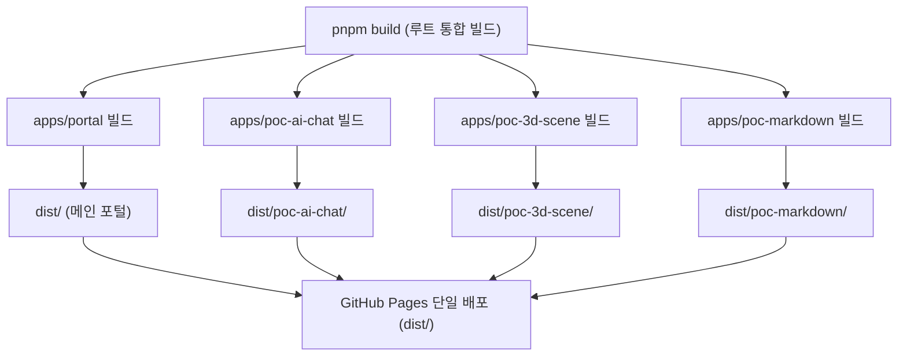

# 📌 Project: Make (Monorepo PoC Testbed & Work Archive)

> **"하나의 저장소 안에서 다양한 독립 웹 애플리케이션을 실험(PoC)하고, 작업 기록을 아카이빙하는 멀티 앱(Multi-App) 정적 플랫폼"**

---

## 1. 아키텍처 비전: Monorepo & Multi-App

본 프로젝트는 **`pnpm Workspaces`** 기반의 모노레포 구조로 설계되어, 각 테스트베드 사이트가 독립적인 기술 스택과 빌드 라이프사이클을 가집니다.

```
make/ (Monorepo Root)
├── apps/
│   ├── portal/          # [메인 허브] 작업 아카이브 및 PoC 카드 쇼케이스 (Vite + React + Tailwind)
│   ├── poc-ai-chat/     # [독립 PoC 1] AI 채팅 UI 및 스트리밍 실험 (React + Tailwind)
│   ├── poc-3d-scene/    # [독립 PoC 2] Three.js 인터랙티브 3D 그래픽 실험 (Three.js / Canvas)
│   └── poc-markdown/    # [독립 PoC 3] 실시간 마크다운 파서 및 뷰어 실험 (Vanilla / Marked)
├── docs/                # 전체 프로젝트 및 사이트별 기획/명세 문서
│   ├── PLANNING.md      # 본 통합 아키텍처 기획서
│   ├── ROADMAP.md       # 마일스톤 및 진행 현황
│   └── apps/            # 각 사이트별 상세 명세 문서
│       ├── portal.md
│       ├── poc-ai-chat.md
│       ├── poc-3d-scene.md
│       └── poc-markdown.md
└── dist/                # [통합 빌드 산출물] GitHub Pages 단일 배포 루트
```

---

## 2. 핵심 기술 스택 및 선정 이유

| 구분 | 도구 | 선정 이유 |
| :--- | :--- | :--- |
| **패키지 매니저** | **pnpm Workspaces** | 하드링크 기반 패키지 공유로 디스크 절약, 초고속 설치, 특정 앱 단독 실행(`pnpm --filter poc-ai-chat dev`) 용이 |
| **빌드 엔진** | **Vite** | 각기 다른 프레임워크(React, Vue, Vanilla 등)를 써도 `vite build`라는 표준화된 인터페이스로 일관되게 번들링 가능 |
| **스타일링** | **Tailwind CSS** | 별도 CSS 번들링 복잡도 없이 유틸리티 클래스로 초고속 프로토타이핑 및 강력한 반응형 지원 |
| **호스팅 / 배포** | **GitHub Pages** (or Cloudflare Pages) | 정적 사이트 기반 제로 서버 유지비, GitHub Actions로 통합 자동 빌드 |

---

## 3. 핵심 기본 원칙 (Core Principles) 📱

모든 사이트(포털 및 개별 PoC 전체)는 아래의 기본 원칙을 필수 준수하여 개발됩니다:

1. **모바일 퍼스트 & 전면 반응형 (Responsive by Default)**
   * 모바일(360px~), 태블릿(768px~), 데스크톱(1024px~) 모든 뷰포트에 유연하게 대응
   * 모바일 전용 UI 패턴 적용:
     * 포털: 카드 1열 그리드 및 모바일 네비게이션
     * AI Chat: 모바일 가상 키보드 호출 시 하단 입력창 고정 및 뷰포트 높이(`dvh`) 대응
     * 3D Scene: 싱글 터치 회전, 핀치 투 줌(Pinch-to-zoom) 모바일 제스처 지원
     * Markdown: 좁은 화면에서는 2열 스플릿 뷰 대신 '에디터 / 프리뷰' 탭 토글 모드로 자동 전환
2. **독립성과 일관성의 균형**
   * 각 PoC는 다른 사이트에 영향을 주지 않고 단독으로 실행/빌드될 수 있어야 함
   * 모든 PoC 상단에는 메인 포털(`/make/`)로 언제든 1클릭 복귀할 수 있는 일관된 네비게이션 바 포함
3. **가벼운 정적 번들**
   * 불필요한 런타임 오버헤드를 줄이고, 정적 파일만으로 완결 동작하는 클라이언트 사이드 기술 채택

---

## 4. 사이트별 역할 및 서브경로 매핑

| 사이트 이름 | 서브 경로 (URL) | 기술 스택 | 핵심 목적 & 반응형 특징 | 상세 명세 |
| :--- | :--- | :--- | :--- | :---: |
| **Portal (Hub)** | `/make/` (Root) | Vite + React + Tailwind | 작업 아카이브 검색, PoC 갤러리 쇼케이스 (반응형 카드 그리드) | [명세서](file:///C:/make/docs/apps/portal.md) |
| **PoC: AI Chat** | `/make/poc-ai-chat/` | React + Tailwind | 대화형 UI, 텍스트 스트리밍 (모바일 키보드 최적화) | [명세서](file:///C:/make/docs/apps/poc-ai-chat.md) |
| **PoC: 3D Scene** | `/make/poc-3d-scene/` | Three.js + Vite | 3D 모델 렌더링, 조명/카메라 조작 (터치 제스처 지원) | [명세서](file:///C:/make/docs/apps/poc-3d-scene.md) |
| **PoC: Markdown** | `/make/poc-markdown/` | Vanilla JS + Marked.js | 실시간 마크다운 파서 및 뷰어 (모바일 스플릿/탭 뷰) | [명세서](file:///C:/make/docs/apps/poc-markdown.md) |

---

## 5. 통합 빌드 및 GitHub Pages 배포 전략

각 사이트는 각자의 빌드 명령어(`build`)를 실행하여 산출물을 생성하며, 루트 빌드 스크립트가 이를 하나의 `dist/` 폴더로 조합합니다.



* **Vite `base` 설정 원칙**:
  * Portal: `base: '/make/'`
  * PoC AI Chat: `base: '/make/poc-ai-chat/'`
  * PoC 3D Scene: `base: '/make/poc-3d-scene/'`
  * PoC Markdown: `base: '/make/poc-markdown/'`

---

## 6. 지속적 문서 및 개발 사이클 규칙

1. **사전 문서화**: 신규 PoC 생성 전 `docs/apps/poc-{name}.md`를 먼저 작성하여 목적, 기능, 모바일 UI 정의
2. **독립 구현**: 타 PoC에 영향 없이 `apps/poc-{name}/` 내에서 독립 개발
3. **로드맵 갱신**: 개발 완료 시 `docs/ROADMAP.md` 상태 업데이트 및 커밋
